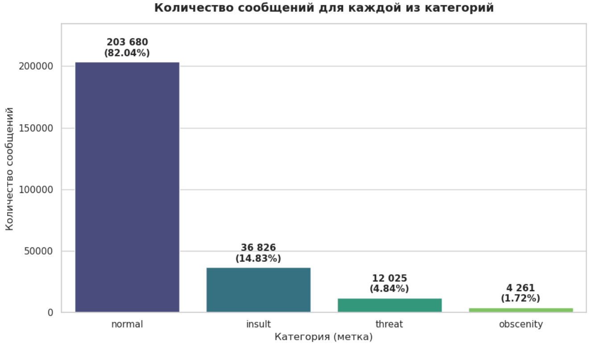
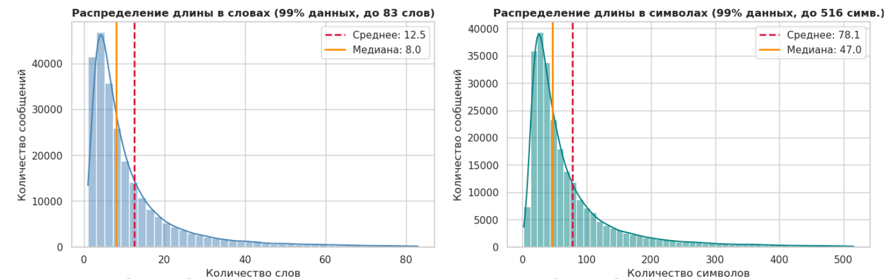
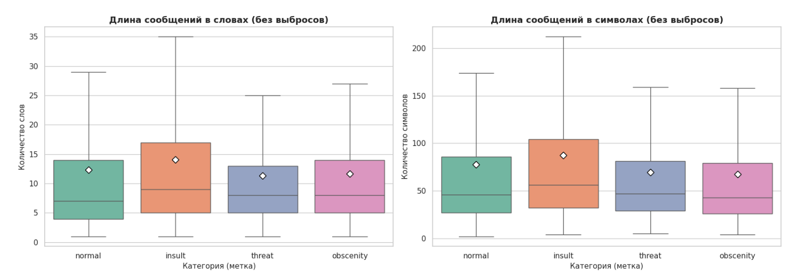
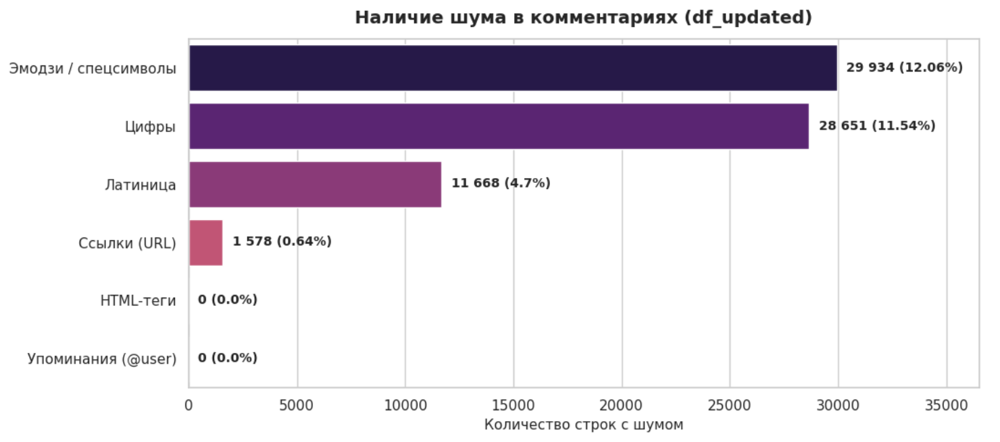
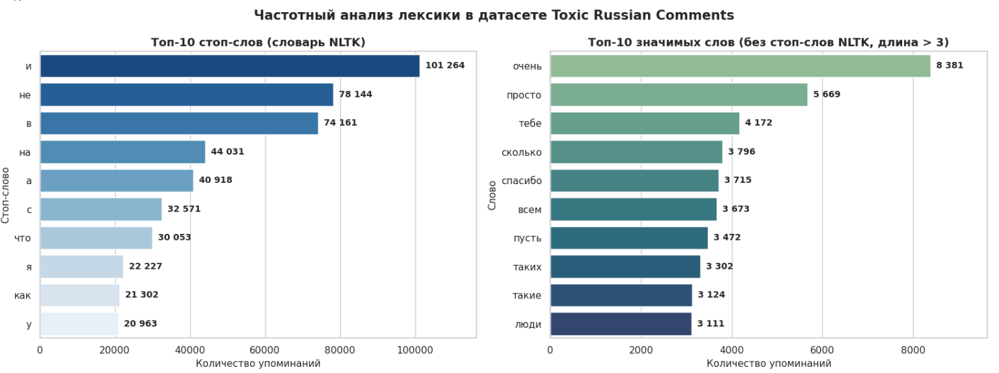
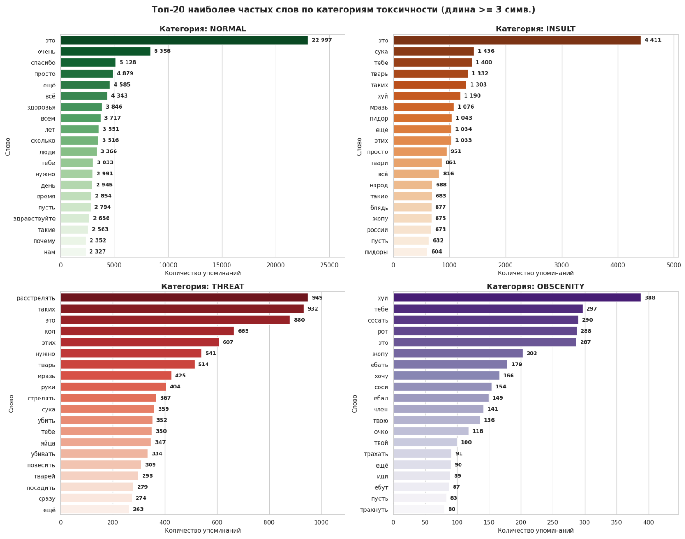
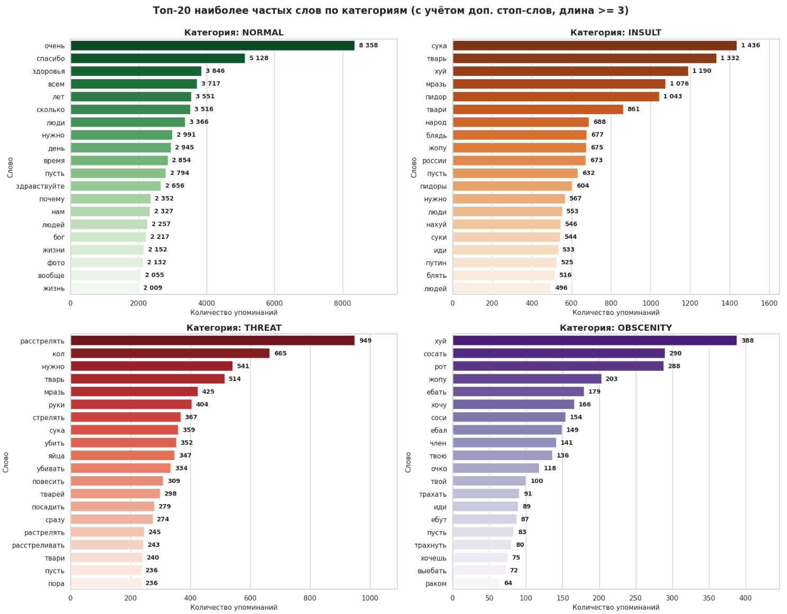

# EDA анализ

Датасет: https://www.kaggle.com/datasets/alexandersemiletov/toxic-russian-comments
Исходник: **dataset.txt** 
Обработанный: **dataset_updated.csv**
Датасет содержит размеченные комментарии из популярной российской социальной сети **ok.ru**. Данные использовались в соревновании на платформе **All Cups**, где участникам нужно было автоматически разметить каждый комментарий хотя бы одним из четырёх предопределённых классов. Классы отражают разные уровни токсичности.
Каждый комментарий относится к одному из следующих классов (разметка в формате fastText):
- `__label__NORMAL` — нейтральные комментарии пользователей;
- `__label__INSULT` — комментарии, унижающие человека;
- `__label__THREAT` — комментарии с явным намерением причинить вред другому человеку;
- `__label__OBSCENITY` — комментарии, содержащие описание или угрозу сексуального насилия.
**Обзор данных (исходник):**
- Количество объектов: **248 290**
- Количество меток: **4**
Распределение меток:
  1. `__label__NORMAL` — 203 685
  2. `__label__INSULT` — 28 567
  3. `__label__INSULT,__label__THREAT` — 6 317
  4. `__label__THREAT` — 5 460
  5. `__label__OBSCENITY` — 2 245
  6. `__label__INSULT,__label__OBSCENITY` — 1 766
  7. `__label__INSULT,__label__OBSCENITY,__label__THREAT` — 176
  8. `__label__OBSCENITY,__label__THREAT` — 74

## Файлы
| Файл                  | Описание                                                     |
| --------------------- | ------------------------------------------------------------ |
| `eda_analysis.ipynb`  | Ноутбук со всем EDA-анализом (шаги 1–6)                      |

## Ключевые шаги EDA анализа (первый пункт чекпоинта)
### Шаг 1. Парсинг в pandas
Датасет прочитан построчно, метки разложены в 4 бинарные колонки (`normal`, `insult`, `threat`, `obscenity`), текст — в колонку `text`. Создан `df`. Стоп-слова загружены через `nltk`
### Шаг 2. Первичный анализ
`shape`, `describe(include='all')`, `info()`, проверка пропусков.
#### Выводы:
- 248 290 объектов, 4 метки, признак - сырой текст;
- Задача мультилейбл-классификации, так как к некоторым текстовым сообщениям принадлежит одновременно пара меток;
- Пропуски не обнаружены;
- В тексте 7 дубликатов, необходима обработка;
- Наблюдается смещение в сторону `normal`, можно сделать вывод, что подавляющее большинство сообщений нейтральны;
### Шаг 3. Дубликаты и аномалии
Найдены 7 дубликатов текста, для удобства они выведены с учетом сортировки. Одна аномалия: слово `сжечь` встречается и в `normal`, и в `threat`.
#### Выводы:
- Дубликаты удалены, датасет сохранён в `df_updated` (248 283 строки);
- `сжечь` оставлен только в `threat`, так как без контекста слово ближе к угрозе по своему смыслу;
- После чистки дубликатов 0, аномалий нет.
### Шаг 4. Дисбаланс классов
Частоты и проценты по каждой метке.
#### Выводы:
- `normal` — 82.03%, `insult` — 14.83%, `threat` — 4.84%, `obscenity` — 1.72%;
- Дисбаланс сильный, стандартные метрики вроде **accuracy могут не подойти**, при обучении модели нужно внимательно подобрать метрики.

### Шаг 5. Длина сообщений
Рассмотрены дополнительные признаки к текстовым сообщениям:
1. Количество символов в каждом сообщении (len_chars);
2. Длина каждого сообщения (len_words);
3. Наличие шума в данных.
К каждому рассмотренному признаку представлена визуализация
#### Выводы (влияние длины сообщения и количества символов на метки):**
- В сообщениях присутствуют фрагменты длиной от 1 до 267 слов, при этом максимальное число символов составляет 998 штук
- Основная масса комментариев (95–99%) укладывается примерно в 60–80 слов (около 400–550 символов), хотя единичные выбросы могут быть до 998 символов. Знаичит, можно не брать слишком большой запас длины сообщения при обучении модели.
- По ящикам с усами видно, что длина сообщения не является чётким разделяющим признаком для меток, поэтому нет смысла добавлять длину в признаки меток.

#### Выводы (анализ присутствия шума в данных):
- В данных отсутствуют никнеймы(@user) и html-теги, доля ссылок миимальна и их можно удалить, так как они нерелевантны для разденеия сообщений на метки.
- Эмодзи и спецсимволы являются важной частью сообщений и могут быть признаком для разделения по меткам, поэтому нужно их учитывать.
- Латиница может использоваться в сообщениях для записи русских слов латинскими буквами или же для обхода блокировок за мат(замена русских букв похожими латинскими). Такие данные нужны для разметки, и их надо учитывать.
- Цифры, вероятно, не несут особого смысла для разметки, но и не мешают обрабатывать данные. Можно оставить как есть.

### Шаг 6. Частотные слова
Проведен анализ наличия стоп-слов в тексте. Затем проведен анализ топ-слов как по всему корпусу, так и по всем меткам в тексте. В итоге получены:
1. Топ стоп-слов по всему тексту;
2. Топ слов по всему корпусу; 
3. Топ слов по каждой метке, для этого реализована функция `count_words`;
Помимо этого проведен дополнительный анализ с расширенным набором стоп-слов`stop_ru_upd`) , в который попали нейтральные по значению и смыслу общие слова из топов в разных метках для конкретизации наполнения топов.

#### Выводы:
- В топ стоп-слов входят предлоги, союзы, частицы. Их нужно убирать из анализа, так как они не несут смысловой нагрузки и засоряют как корпус текста, так и по сообщения по меткам;
- Наиболее часто встречающиеся слова в датасете представляют собой нейтральные слова. Это может быть связано с тем, что больше 80% сообщений в датасете представляют собой нейтральные сообщения. Также можно отметить, что неучет слов с небольшим количеством знаков приводит к большему пониманию смысла выдаваемых слов: убираются мусорные слова, знаки препинания, случайные буквы и т.д; 
- Несмотря на улучшение контекста выдаваемых слов при условии количества букв не менее 4 (к примеру), это приводит к сокращению в выдаче матерных слов "хуй" (к примеру), так что это граница видится крайне субъективной. В дальнейшем, при обучении модели, могут понадобиться именно слова с определенным смыслов из данных категорий, поэтому это видится крайне важным вопросом. Возможно, стоит добавить в список стоп-слов такие слова как "это", которые не выражают определенного, однозначного смысла;
- Видно, что метка normal содержит нейтральные слова. Метка insult - слова-оскорбления (за исключением нейтральных слов, которые можно также обозначить как стоп-слова в будущем), метка threat - слова, связанные с угрозой или намерением (стрелять, расстрелять), также здесь присутсвуют оскорбительные слова (замешанные с нейтральными, потенциальными стоп-словами), метка obscenity - слова с матерной лексикой (в данном случае нейтральных слов меньше, чем для остальных меток). Можно сделать вывод о том, что анализируемый датасет представляет собой удобные для обучения данные, где слова семантически разделены по соответсвующим группам
- Добавление новых стоп-слов, найденных по результатам анализа топ-слов для каждой метки, помогает конкретизировать облако топ-слов, характерных для рассматриваемых категорий в датасете, как видно из полученных результатов;
- В метке insult встречаются такие слова как "путин, народ, россии" - политически-окрашенные слова. Возможно, в будущем, при обучении, могут возникнуть проблемы именно вследствие того, что политически-нейтральные тексты также будут считываться как insult, если в них будут встречаться подобные слова. На это стоит обратить внимание;

---
## Итоговые выводы EDA
1. Всего в датасете представлено изначально 248290 объекта, 4 метки и один признак в виде текстовых сообщений. В датасете отсутствовали пропуски, обнаруженные дубликаты были обработаны и удалены. Обновленный датасет в ноутбуке - df_updated;
2. Можно отметить достаточно сильный дисбаланс классов в сторону normal. Потенциально это говорит о том, что в будущем нужно аккуратно выбирать метрики под модели - стандартные метрики вроде Accuracy тут работать не будут Процентное соотношение сообщений каждой из категорий относительно всего корпуса: normal 82.03 % insult 14.83 % threat 4.84 % obscenity 1.72 %
3. В сообщениях присутствуют фрагменты длиной от 1 до 267 слов, при этом максимальное число символов составляет 998 штук, медианы len_words: normal ~7, insult ~9, threat ~8, obscenity ~8 - то есть длина сообщения и количество символов представляются незначительными для дополнительного анализа признаками, они ничего не показывают
4. Наиболее часто встречающиеся слова в датасете представляют собой нейтральные слова. Это может быть связано с тем, что больше 80% сообщений в датасете представляют собой нейтральные сообщения. Также можно отметить, что неучет слов с небольшим количеством знаков приводит к больше пониманию смысла выдаваемых слов: убираются мусорные слова, знаки препинания, случайные буквы и т.д.;
5. Несмотря на улучшение контекста выдаваемых слов при условии количества букв не менее 4 (к примеру), это приводит к сокращению в выдаче матерных слов "хуй" (к примеру), так что это граница видится крайне субъективной. В дальнейшем, при обучении модели, могут понадобиться именно слова с определенным смыслов из данных категорий, поэтому это видится крайне важным вопросом. Возможно, стоит добавить в список стоп-слов такие слова как "это", которые не выражают определенного, однозначного смысла.
6. Видно, что метка normal содержит нейтральные слова. Метка insult - слова-оскорбления (за исключением нейтральных слов, которые можно также обозначить как стоп-слова в будущем), метка threat - слова, связанные с угрозой или намерением (стрелять, расстрелять), также здесь присутсвуют оскорбительные слова (замешанные с нейтральными, потенциальными стоп-словами), метка obscenity - слова с матерной лексикой (в данном случае нейтральных слов меньше, чем для остальных меток). Можно сделать вывод о том, что анализируемый датасет представляет собой удобные для обучения данные, где слова семантически разделены по соответсвующим группам, но это не отменяет дисбаланса классов - их надо учитывать при моделировании».
7. В метке insult встречаются такие слова как "путин, народ, россии" - политически-окрашенные слова. Возможно, в будущем, при обучении, могут возникнуть проблемы именно вследствие того, что политически-нейтральные тексты также будут считываться как insult, если в них будут встречаться подобные слова. На это стоит обратить внимание.
8. В сообщениях большое количество эмодзи, которые релевантны для разметки, а также присутствует латиница (транслит, замена букв для обхода блокировок). Нужно учитывать это при дальнейшей работе с данными.
9. Видится полезным использование списка стоп-слов и его расширение (например, добавление форм личных и притяжательных местоимений) для корректной разметки.
10. Вероятно, имеет смысл добавить как признаки меток сочетания слов, которые именно вместе не являются нейтральными, а говорят об угрозе или оскорблении.